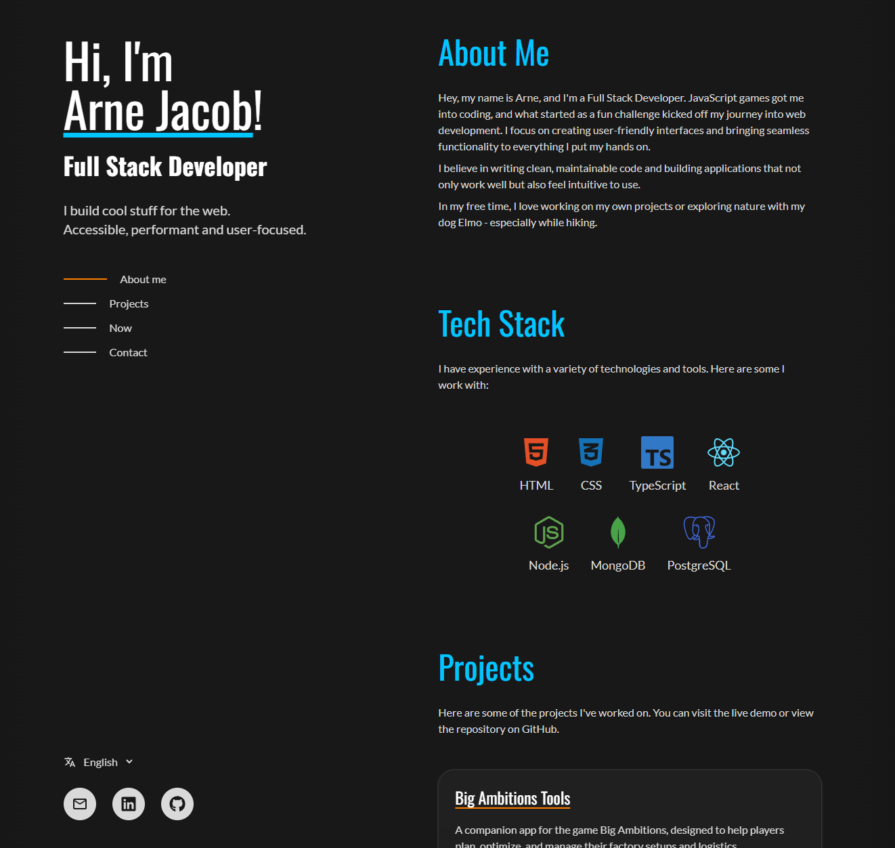

# Personal Portfolio

Personal portfolio website with a React frontend and an Express backend.

- Responsive portfolio UI
- GitHub activity integration
- Spotify now-playing integration
- Dockerized deployment
- Shared TypeScript setup

## Tech Stack

- Frontend: React, TypeScript, Vite, Tailwind CSS
- Backend: Express, TypeScript
- Tooling: npm workspaces, Docker Compose

## Live Demo

<https://dudeldups.dev>

## Preview



## Requirements

- Node.js 22+
- npm
- Docker (optional, for containerized runs)

## Environment Files

Create the following environment files:

- `frontend/.env`
- `backend/.env`

Use the provided `.env.example` files as templates.

## Local Development

Install dependencies from the project root:

```powershell
npm install
```

Start frontend and backend together:

```powershell
npm run dev
```

Default local URLs:

- Frontend: `http://localhost:5173`
- Backend: `http://localhost:4000`

## Docker

### Production-style Compose

Uses the single-container setup intended for the server:

```powershell
docker compose build
docker compose up -d
```

## Notes

- The frontend calls the backend through `/api/...`
- GitHub and Spotify responses are cached in the backend
- The backend serves the built frontend in production

## Spotify operation

The Spotify card refreshes on demand, at most once per `SPOTIFY_CACHE_TTL_MS`
(default 120 seconds) per backend process. Visible browser tabs check the
local backend every 30 seconds, or retry after 10 seconds if an HTTP request fails.
Tabs check again immediately on becoming visible. These checks do not make extra
Spotify API calls while its cache or a Retry-After cooldown is active. Concurrent
visitors share one refresh. An expired cache returns a still-valid last-known track immediately and refreshes
in the background. Without a last-known track, it waits up to eight seconds
before returning a temporary-unavailable response; a late refresh is available
to the next browser request. Access tokens are
reused until shortly before expiry, and Spotify calls individually time out after
five seconds. No requests are made to Spotify while the site is idle.
A Spotify change can remain unseen for up to one cache TTL plus one browser poll
interval (normally about 150 seconds), plus request latency and scheduling delays.
On failure, an observed track is returned immediately as last known for up to
24 hours after its last successful observation. The display never calls this live playback. It shows the real
Spotify played-at timestamp, or explicitly identifies an observation timestamp
when Spotify did not supply a played-at value. Hidden tabs revalidate on activation.

On a 429, the backend honors `Retry-After` and applies exponential backoff (one
minute initially, up to 30 minutes, or longer if Spotify requests it). Network and
server failures use the same bounded backoff. Authentication and access errors
(including 401, 403 and invalid refresh grants) are retried at most hourly; check
credentials, scopes, app access and quota mode if they persist. Failures are logged
once per attempted refresh with status, operation, next attempt and failure count;
recovery is logged once. No tokens or response bodies are logged. Fresh responses and cooldown state remain in memory. On a successful track fetch,
track metadata is also atomically saved to the optional `SPOTIFY_LAST_KNOWN_FILE`.
The file is validated at startup and must reside on a mounted persistent Docker
volume to survive container recreation. Neither tokens nor secrets are saved.
A valid snapshot is always stale after loading. Snapshots expire after 24 hours,
are deleted when they expire while the backend is running, and are removed on
the next startup if the backend was stopped at expiry. A successful empty history can
still display an earlier known track as stale. Without any previously observed
track or valid snapshot, an upstream failure still produces HTTP 503.

The previous implementation refreshed every minute even without visitors, obtained
a new access token each time, ignored `Retry-After`, and allowed each stale-cache
request to restart a failed refresh. These behaviors explain the repeated attempts
and log messages; the repository alone cannot establish which traffic or Spotify
quota caused the original 429. Spotify applies limits across the app's rolling
30-second window; inspect its Developer Dashboard and other applications sharing
the client ID when diagnosing sustained limits. A 429 alone does not establish a
permanent quota restriction. Check Development Mode account and access requirements
separately from rate limits.

The included Compose file runs one backend process. Caching and backoff are local to
that process: additional replicas or other consumers of the same Spotify client ID
increase aggregate calls and do not share cooldowns. Route all Spotify requests to
one backend instance, or introduce a shared coordinator before scaling replicas.
Restarting the process clears its fresh cache and cooldown, but a snapshot
stored on a persistent Docker volume survives.

After deployment, inspect the backend logs for `Spotify rate limited` and its
`retryAt` value. There should be no new Spotify refresh failure from that process
before that time; `Spotify refresh recovered` records a successful later attempt.
Persistent authorization warnings require configuration/access investigation, and
persistent 429s require checking dashboard traffic and all client-ID consumers.
No production deployment is part of this change.

References: [Spotify rate limits](https://developer.spotify.com/documentation/web-api/concepts/rate-limits),
[API caching guidance](https://developer.spotify.com/documentation/web-api/concepts/api-calls),
[Developer Terms](https://developer.spotify.com/terms), and
[Development Mode migration guide](https://developer.spotify.com/documentation/web-api/tutorials/february-2026-migration-guide).

### Isolated Docker persistence test

On Windows PowerShell from the repository root, build the test image and run:

```powershell
docker build -f backend/Dockerfile -t personal-portfolio-spotify-persistence-test .
./backend/test/docker/persistence.ps1
```

The test uses dummy credentials and a mocked Spotify service, disables container
networking, and removes only its own temporary containers and named volume.

### Deploying the persistent Spotify fallback on the VPS

The real production Compose file is not tracked in this repository. Use the
[deployment migration guide](docs/spotify-vps-migration.md) to inspect the
existing container and capture any usable in-memory track **before** replacing
it, preserve all existing settings, and prepare a volume. A valid snapshot is
necessary for an immediate fallback if Spotify is unavailable on first start.
A snapshot expires after 24 hours; no fallback can be guaranteed beyond that.
The guide is preparation only: this change does not deploy or modify the VPS.
